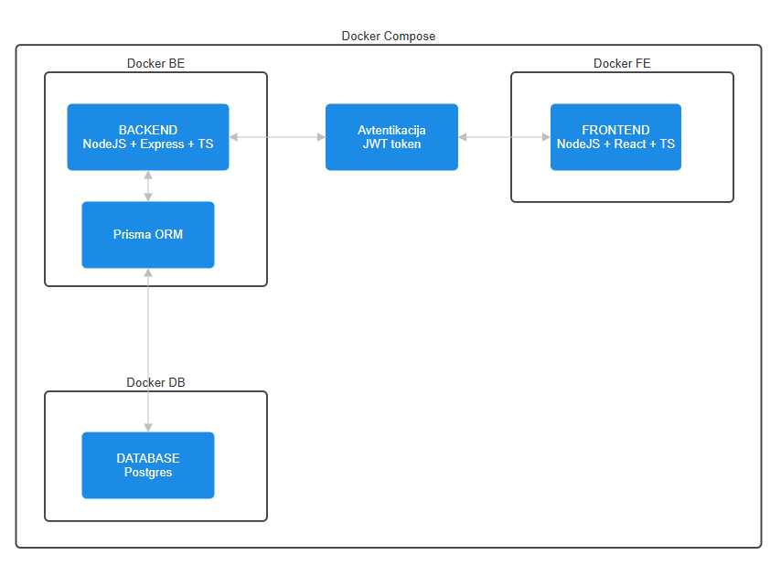

## Tehnična zasnova rešitve


Arhitektura:

glavne dele sistema,
komunikacijo med deli sistema,
podatkovno bazo,
način avtentikacije oziroma upravljanja uporabnikov,
način lokalnega zagona.
Dodajte tudi preprost diagram.

Tehnološki sklad

Navedite tehnologije in orodja za:

frontend,
backend,
podatkovno bazo,
avtentikacijo,
lokalni razvoj,
morebitne druge dele aplikacije.
Arhitekturne odločitve

Vse pomembne arhitekturne odločitve ali izbire na kratko utemeljite.


# Arhitektura

```
`Frontend` - react + typescript 
`Backend` - express + typescript
`NodeJS` - runtime environment 
`Odločitve` po izvajalnem okolju NodeJS za FE in BE - potreba po strogo tipiziranem jeziku, za lažje preprečevanje napak in povezavo z bazo. Povezava BE in FE `preko` enotnega programskega jezika - manj konfliktov med knjižnicami, tipi in ostalimi omejitvami med programskimi jeziki
`Prisma` - shema in komunikacija z bazo (ni potrebe po pisanju SQL, podpira JS in TS knjižnice, lahka integracija v BE)
`Database` - postgres (striktna struktura)
`Avtentikacija` - JWT token (zanesljivo in enostavno preverjanje pristnosti, že obstaja knjižnica v JS, JWT se bo shranjeval v brskalniku, ni potrebe po alternativnem shranjevanju - lahka implementacija)
`Lokalni razvoj` - Docker (enostavno in prenosljivo)
```



Vstopna točka uporabnikom je React frontend spletna storitev. Uporabnik se prijavi in avtenticira preko JWT žetona (komunikacij z Express backendom). Vsa komunikacija z bazo poteka preko backenda in JWT avtentikacije. Za lažjo komunikacijo z bazo uporabljam Prisma ORM. FE, BE in DB se nahajajo znotraj svojih Docker zabojnikov, povezani pa so v isto omrežje preko Docker Compose.

Lokalni zagon tako poteka z Dockerjem - `docker compose up`
